# QueueSense

## Don’t stand in line. Know your turn.

QueueSense is an AI-assisted smart queue management prototype for high-demand service counters. It combines **browser-based computer vision** with a **digital token queue**, allowing people to leave a physical line and monitor their turn remotely.

> **Product principle:** computer vision estimates the physical queue; digital tokens represent people in the managed queue. The two layers are intentionally separate. QueueSense never performs facial recognition or person-to-token matching.

## Live demo

- **Preview:** https://3000-i64ox1pwhojvyv6sdzcab-468873ac.sg2.manus.computer
- **Student dashboard:** `/student`
- **Staff console:** `/staff`
- **Camera station:** `/camera`
- **Admin insights:** `/admin`

The default demo is zero-setup: it persists state in `localStorage` and synchronizes browser tabs through `BroadcastChannel`, so the three-device hackathon flow works even before a hosted database is configured. The Supabase schema and adapter plan are included in [`docs/supabase-schema.sql`](./docs/supabase-schema.sql).

## Problem

Students and visitors lose time physically standing at admissions offices, accounts counters, libraries, hospitals, transport counters, and similar services. A raw people counter does not solve the waiting problem; the person needs a reliable digital place and a clear moment to return.

## Solution workflow

```mermaid
flowchart LR
  A[Camera Station] --> B[COCO-SSD detects people locally]
  B --> C[ROI filter + temporal smoothing]
  C --> D[Aggregate physical queue metric]
  D --> E[Approximate wait estimate]
  E --> F[Student gets digital token]
  F --> G[Student leaves the physical queue]
  G --> H[Realtime token position + alert]
  H --> I[Staff calls, serves, completes]
```



## Features

- Public landing page focused on the actual waiting problem
- Student dashboard with service cards, queue size, estimated wait, digital token, people ahead, progress, cancellation, and status alerts
- Staff console with call next, start serving, complete, skip, pause/resume, queue list, recent activity, and live metrics
- Camera station with:
  - webcam permission flow and friendly fallback when permission is unavailable
  - TensorFlow.js + COCO-SSD script loading
  - person-only detection
  - visible bounding boxes
  - configurable confidence threshold
  - visible Queue Region of Interest (ROI)
  - center-point ROI filtering
  - raw count versus smoothed count
  - local-only processing and privacy messaging
  - demo controls for reliable judging without a webcam
- Admin/insights dashboard with throughput chart, system health, service performance, and architecture explanation
- Cross-tab realtime demo synchronization using `BroadcastChannel` and storage events
- Deterministic valid token states: `WAITING → CALLED → SERVING → COMPLETED`, with `CANCELLED` and `SKIPPED` exits
- Reset demo data action for repeatable presentations
- Responsive layouts for desktop, tablet, and mobile
- Vitest coverage for queue-position and wait-time logic plus the scaffold auth test

## Final architecture

### Demo architecture

- **React + Vite + TypeScript** renders all dashboards.
- `client/src/lib/demoStore.ts` owns the queue state, persistence, derived positions, and transitions.
- `localStorage` provides persistence across refreshes.
- `BroadcastChannel` plus the `storage` event synchronizes tabs and simulates the same realtime behavior judges will see across devices.
- The camera station runs detection in the browser and writes only an aggregate physical count to the shared store.

### Production architecture

- React client remains the presentation layer.
- Supabase Auth identifies students/staff/admins.
- Supabase PostgreSQL stores services, counters, queue entries, events, camera stations, and aggregate metrics.
- Supabase Realtime publishes queue entry, event, and metric changes.
- Row Level Security limits staff actions to assigned counters and admin actions to configuration tables.
- The server-side template layer remains available for protected operations and future RPC procedures; secret/service-role keys are never sent to the browser.

### Explicit code layers

| Layer | Code location | Responsibility |
| --- | --- | --- |
| Frontend | `client/src/pages`, `client/src/components`, `client/src/lib/demoStore.ts` | Responsive UI, camera inference, local fallback state, user interactions |
| Backend | `server/queueDb.ts`, `server/_core/*` | Database connection, persistence helpers, auth/runtime boundary |
| API | `server/routers.ts` via tRPC under `/api/trpc` | Typed queue status, token creation, queue event, and camera metric procedures |
| Database | `drizzle/schema.ts` + `drizzle/0001_clear_nehzno.sql` | MySQL relational tables, foreign keys, indexes, and state/event history |

Frontend-to-backend integration uses **tRPC**, which is the typed equivalent of REST for this project. The shared `AppRouter` gives the React client compile-time request/response types and the scaffold maps procedures to `/api/trpc` without a second handwritten API client.

## Backend API contract

| Procedure | Method | Purpose | Persistence |
| --- | --- | --- | --- |
| `queue.status` | query | Reports API mode, relational database mode, and realtime adapter status | Reads the database connection state |
| `queue.join` | mutation | Creates the next sequence/token for a service and counter | Inserts `queueEntries` + `queueEvents` when the database is available |
| `queue.event` | mutation | Records `JOINED`, `CALLED`, `SERVING`, `COMPLETED`, `SKIPPED`, or `CANCELLED` history | Inserts an auditable `queueEvents` row |
| `queue.metric` | mutation | Stores aggregate people count and estimated wait from a camera station | Inserts `queueMetrics`; no video or identity data |

The frontend calls `queue.status` from the shared shell so every dashboard visibly reports the active API/persistence mode. The local-first store remains the graceful fallback for a demo without seeded database records; the relational procedures are ready for the next adapter step.

## Folder structure

```text
client/
  index.html                     # app metadata + TensorFlow.js/COCO-SSD scripts
  src/
    App.tsx                      # route map and providers
    index.css                    # QueueSense design system
    components/
      QueueSenseShell.tsx        # shell, nav, shared UI primitives
      ui/                        # scaffold UI components
    lib/
      demoStore.ts               # local persistence + cross-tab sync + queue transitions
      queueLogic.test.ts         # queue calculation tests
    pages/
      Landing.tsx
      StudentDashboard.tsx
      StaffDashboard.tsx
      CameraStation.tsx
      AdminDashboard.tsx
docs/
  supabase-schema.sql            # PostgreSQL schema, indexes, realtime, RLS
server/
  routers.ts                     # template tRPC/auth entry point
  db.ts                          # template database access
  _core/                         # managed auth/runtime infrastructure
README.md
vitest.config.ts
```

## Technology stack

| Layer | Technology | Reason |
| --- | --- | --- |
| Frontend | React 19, Vite, TypeScript | Fast iteration, typed component boundaries |
| Styling | Tailwind 4 imports + QueueSense CSS tokens | Responsive layout with a distinctive visual system |
| Icons | Lucide React | Lightweight, consistent, accessible icons |
| Vision | TensorFlow.js + COCO-SSD | Browser-only inference with a pre-trained person detector |
| Camera | `getUserMedia` + `<video>` + `<canvas>` | No video upload or separate ML server |
| Demo persistence | `localStorage` + `BroadcastChannel` | Zero-setup multi-tab synchronization for judging |
| Production database | Supabase PostgreSQL | Relational schema, auth, realtime, and RLS |
| Backend scaffold | tRPC + Express + Drizzle + Manus OAuth | Typed server boundary and project-ready authentication |
| Testing | Vitest + TypeScript check + Vite build | Fast validation before demos |

## Data model and relationships

- `profiles` maps `auth.users` to a product role.
- `services` define destinations and average service time.
- `counters` belong to services and optionally map to assigned staff.
- `queue_entries` belong to a counter/service and hold the digital token state.
- `queue_events` form an auditable event history for each token.
- `camera_stations` belong to counters and store ROI configuration, not video.
- `queue_metrics` store aggregate people counts and approximate wait values over time.

### Important indexes

- Active queue entries by `(counter_id, status, sequence_number)` for next-token selection.
- User active entries by `(user_id, status)` for the student’s current token.
- Queue events by `(queue_entry_id, created_at desc)` for activity history.
- Metrics by `(camera_station_id, captured_at desc)` for latest camera state.

### Realtime tables

`queue_entries`, `queue_events`, and `queue_metrics` are the realtime publication surface. A student listens for their entry and the relevant counter; staff listens for queue membership and operational events; the public dashboard listens for recent aggregate metrics.

## Computer vision design

1. Request webcam permission only after the operator clicks **Use webcam**.
2. Load COCO-SSD in the browser.
3. Filter predictions to `class === "person"` and the configured confidence threshold.
4. Draw the detections and ROI on a canvas overlay.
5. Calculate each bounding-box center and count only centers inside the ROI.
6. Apply a rolling median over recent counts to reduce one-frame jumps.
7. Persist only the aggregate count and derived estimate.

**Why COCO-SSD?** It is appropriate for a hackathon because it is pre-trained, browser-compatible, easy to explain, and supports person detection without training a custom model.

**Why TensorFlow.js?** Inference can run locally in the browser, which reduces infrastructure, latency, and privacy exposure.

**Why not facial recognition?** It is unnecessary to solve queue waiting and would introduce privacy, consent, bias, and security risks.

## Wait-time formula

```text
physical_estimated_wait_minutes
  = filtered_people_inside_roi × average_service_time_minutes

digital_estimated_wait_minutes
  = people_ahead_in_digital_queue × average_service_time_minutes
```

The UI deliberately says **Estimated**, **Approx.**, and **May vary**. Camera angle, occlusion, lighting, model confidence, service speed, and no-shows can all affect the result.

## Roles and workflows

### Student

1. Open Live queues.
2. Select Admissions Office.
3. Review physical count and approximate wait.
4. Select **Get digital token**.
5. Monitor token, current token, people ahead, and progress remotely.
6. Watch for **almost your turn / called** state.
7. Return to the counter and see **Completed** after staff finishes.

### Staff

1. Open Staff console.
2. Select the assigned service.
3. Complete the current token or call the next token.
4. Start serving, complete, or skip.
5. Pause/resume the queue when the counter is unavailable.
6. Observe physical count, queue list, activity, and service statistics.

### Admin

Review service health, throughput, realtime health, counter performance, and the privacy/architecture split. Production admin actions are protected by the `admin` role in the Supabase policies.

## Setup and run locally

```bash
pnpm install
pnpm dev
```

The application runs at the local Vite/Express dev URL printed by the command.

Useful checks:

```bash
pnpm check       # TypeScript
pnpm test        # Vitest (4 tests at the time of writing)
pnpm build       # Vite client build + server bundle
```

### Environment variables

The full-stack template provides the runtime variables in its managed environment: `DATABASE_URL`, `JWT_SECRET`, `VITE_APP_ID`, `OAUTH_SERVER_URL`, `VITE_OAUTH_PORTAL_URL`, `OWNER_OPEN_ID`, `OWNER_NAME`, and the built-in API variables.

For a hosted Supabase adapter, add:

```text
VITE_SUPABASE_URL=https://<project-ref>.supabase.co
VITE_SUPABASE_ANON_KEY=<public-anon-key>
```

Only the public anon key belongs in the browser. Never expose a service-role key, private token, or database password in client code.

## Supabase setup

1. Create a Supabase project.
2. Run [`docs/supabase-schema.sql`](./docs/supabase-schema.sql) in the SQL editor.
3. Enable email/password or the chosen auth provider.
4. Create demo users and set their `profiles.role` to `student`, `staff`, or `admin`.
5. Seed services, counters, and a camera station.
6. Add the public URL and anon key as environment variables.
7. Replace the demo-store read/write adapter with Supabase queries and subscribe to the three realtime tables.
8. Keep the UI contracts unchanged: service summaries, queue entries, and status transitions remain the same.

## End-to-end demo script

**Three-device version:**

1. Laptop 1: open `/camera`; show the ROI, bounding boxes, `4 people`, and `~12 min`.
2. Laptop 2: open `/student`; select Admissions Office and show token `A018`, current `A014`, 3 ahead, and `~9 min`.
3. Laptop 3: open `/staff`; show `A014` serving and `A015–A019` next.
4. On staff: click **Complete**. Student view updates to remove A014 without refresh.
5. On staff: click **Call next**. The next token becomes `CALLED`; student view shows the prominent called state when it reaches the demo student.
6. Click **Start serving**, then **Complete**. Student view ends at `COMPLETED`; statistics increment.
7. Return to `/camera` and change the demo count or use a webcam to demonstrate the physical estimate changing independently of the digital token queue.
8. Click **Reset demo data** before repeating.

## Testing checklist

- [x] Routes render: `/`, `/student`, `/staff`, `/camera`, `/admin`.
- [x] Student token creation is idempotent for the demo student.
- [x] People ahead ignores completed/cancelled entries.
- [x] Wait estimate uses the configured average service time.
- [x] Staff controls prevent calling when another token is active.
- [x] Start serving requires `CALLED`.
- [x] Complete/skip require an active token.
- [x] Pause blocks new token creation.
- [x] Camera permission failures switch to demo mode with a readable message.
- [x] ROI count is separate from raw detections.
- [x] Rolling median smoothing reduces count jitter.
- [x] Cross-tab state uses BroadcastChannel/storage events and requires no manual refresh.
- [x] `pnpm check` passes.
- [x] `pnpm test` passes.
- [x] `pnpm build` passes.

## Known limitations

- The default demo store is intentionally local-first; it is not a replacement for Supabase in production.
- Realtime synchronization is simulated across tabs until the Supabase adapter is connected.
- Browser camera inference depends on camera position, lighting, occlusion, device performance, and model confidence.
- Wait times are approximate and do not account for service variability, no-shows, or counter downtime.
- Browser camera permissions require HTTPS or localhost and user consent.
- The prototype does not claim guaranteed push notifications or production-grade surveillance accuracy.
- Authentication and RLS are scaffolded for the production adapter; the hackathon demo is designed to be frictionless for judges.

## Future improvements

- Connect `demoStore` to Supabase queries and Realtime subscriptions.
- Add a server-side transition function/transaction so two staff devices cannot call the same token.
- Add Web Push/SMS/email notifications with explicit opt-in.
- Support multiple cameras per counter and confidence/calibration history.
- Add wait-time calibration from completed service durations.
- Add accessibility review, audit logs, rate limits, and automated RLS tests.
- Add station-level health monitoring and offline retry queues.

## Suggested Git workflow and commits

Use `main` for stable demos and short-lived feature branches:

```text
feature/camera-cv
feature/student-dashboard
feature/staff-dashboard
feature/supabase-realtime
feature/ui
feature/auth-security
```

Suggested commits:

```text
feat: add QueueSense landing page and design system
feat: add local digital token workflow
feat: add camera ROI and smoothed person count
feat: add staff queue controls and metrics
feat: add cross-tab realtime demo synchronization
feat: add Supabase schema and RLS policies
test: cover queue position and wait estimates
fix: handle camera permission fallback
style: refine responsive dashboard layouts
```

## Important technical decisions

1. **Local-first demo state:** a two-day hackathon needs a reliable demo without a secrets/setup failure. The adapter boundary makes hosted Supabase the next step rather than a blocker.
2. **No face identity:** aggregate detection solves the problem and is safer than identity tracking.
3. **ROI + median smoothing:** both are simple enough to explain to judges and address the most visible false-count issues.
4. **Explicit state machine:** action buttons are enabled only for valid transitions so the UI mirrors the queue rules.
5. **Separate physical and digital queues:** this preserves the product truth: a physical estimate is a signal, while a digital token is a managed place.
6. **Minimal admin scope:** useful operations and analytics without overbuilding features that would not improve the demo.
