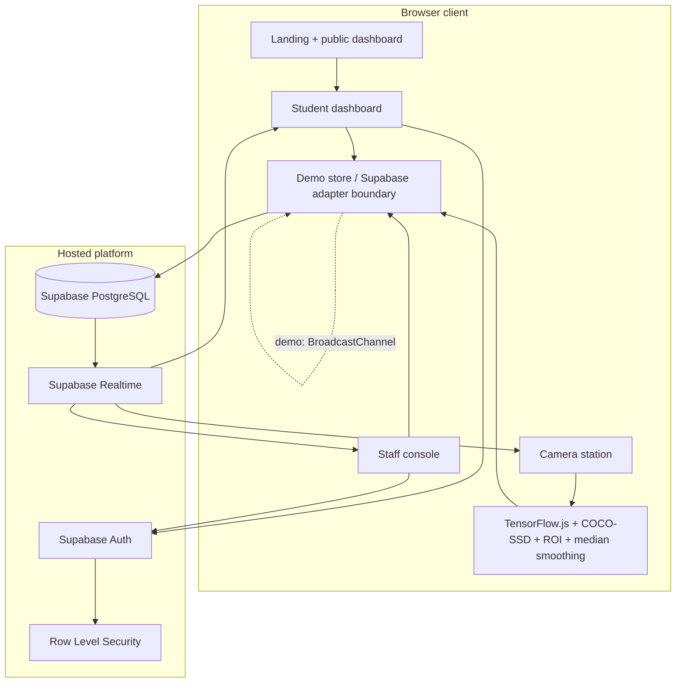
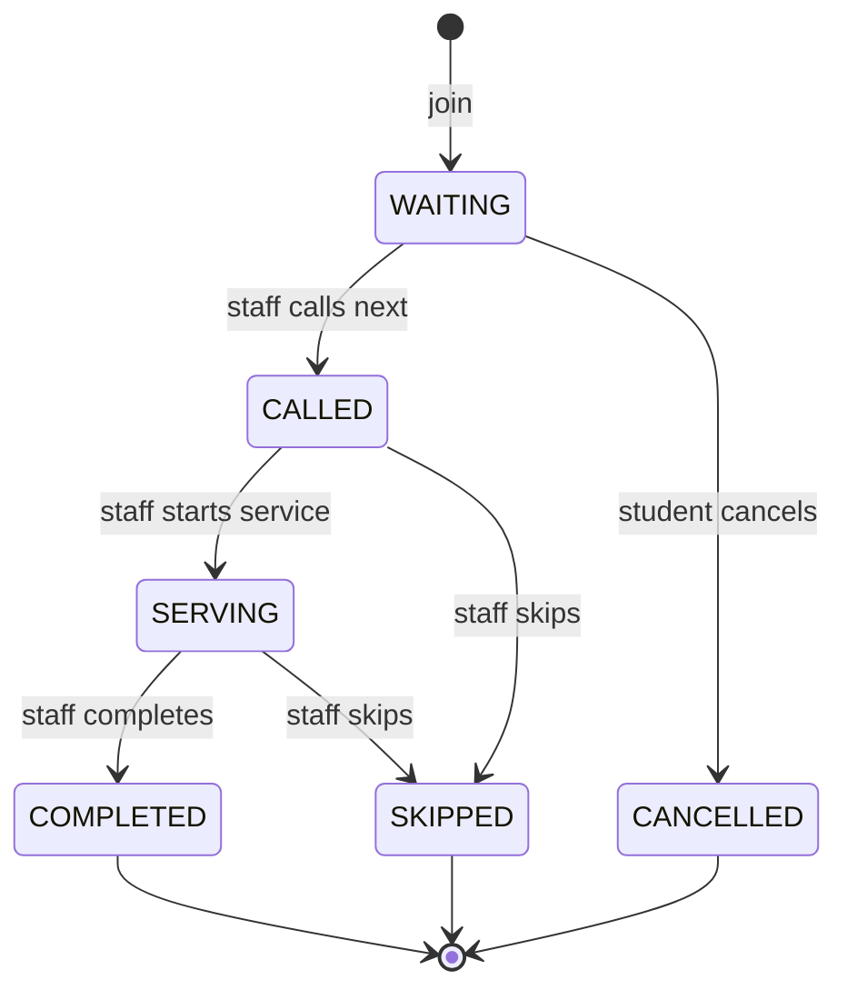

# QueueSense technical design

## 1. Final architecture



The shipped demo uses the same UI contracts but a local store, which removes Supabase credentials as a failure point during a student hackathon. The production boundary is intentionally narrow: replace store reads/writes and subscriptions, not the pages.

## 2. Folder structure

```text
client/src/
  components/QueueSenseShell.tsx  shared shell + primitives
  lib/demoStore.ts                state, persistence, sync, calculations
  lib/queueLogic.test.ts          domain tests
  pages/Landing.tsx
  pages/StudentDashboard.tsx
  pages/StaffDashboard.tsx
  pages/CameraStation.tsx
  pages/AdminDashboard.tsx
  App.tsx
  index.css
server/
  _core/                           managed runtime/auth
  db.ts                            database access boundary
  routers.ts                       tRPC contract boundary
docs/
  supabase-schema.sql
  TECHNICAL_DESIGN.md
```

## 3. Database design

| Table | Purpose | Key relationships | Realtime? |
| --- | --- | --- | --- |
| `profiles` | Role-aware app identity | `auth.users` | No |
| `services` | Available destinations and average service time | one-to-many `counters` | Config changes optional |
| `counters` | Physical counter assigned to staff | `services`, `profiles` | Queue status useful |
| `queue_entries` | Digital tokens and state | `services`, `counters`, optional `profiles` | Yes |
| `queue_events` | Auditable state changes | `queue_entries`, actor profile | Yes |
| `camera_stations` | Camera and ROI configuration | `counters` | Config changes optional |
| `queue_metrics` | Aggregate physical count + wait | `camera_stations` | Yes |

The full SQL, indexes, enum constraints, realtime publication, and RLS policies are in [`supabase-schema.sql`](./supabase-schema.sql).

## 4. Data relationships and security

- A service has one or more counters.
- A counter can have one assigned staff member and one or more camera stations.
- A queue entry belongs to exactly one service/counter and optionally one authenticated student.
- Queue events are append-only audit records.
- Camera metrics have no face, frame, or identity columns.
- Students can create/cancel their own entries and read active public queue state.
- Staff can mutate entries only for counters assigned to them.
- Admins manage services and counters.
- The browser receives only the Supabase anon key; service-role credentials stay server-side.

## 5. Realtime architecture

### Demo path

1. An action calls a pure store transition.
2. The new state is written to `localStorage`.
3. The current tab dispatches a custom event.
4. Other tabs receive the state through `BroadcastChannel` or the browser storage event.
5. Student, staff, camera, and insights pages derive their views from the same state.

### Supabase path

- `queue_entries` updates drive student token state and staff queue lists.
- `queue_events` drives recent activity and audit views.
- `queue_metrics` drives public physical queue counts and wait estimates.
- Optimistic UI is appropriate for reversible demo actions; critical production transitions should be server-side transactions.

## 6. Computer vision architecture

- `getUserMedia` starts only from a user action.
- COCO-SSD predictions are filtered to the `person` class.
- A bounding-box center point is tested against `{ x: .12, y: .20, width: .76, height: .64 }`.
- The ROI is visible so judges can see why outside people do not count.
- The rolling median smooths transient 3 → 4 → 3 → 5 → 4 count jitter.
- Only `people_count` and `estimated_wait_minutes` are eligible for persistence.

## 7. User workflows

### Student workflow

`Open → choose service → inspect estimate → join → leave physical queue → monitor position → receive called state → return → completed`

### Staff workflow

`Open console → choose counter → complete current or call next → start serving → complete/skip → repeat → pause/resume as needed`

### Judge workflow

`Camera demo → student token → staff action → cross-tab update → completion → statistics update`

## 8. Token state machine



The UI prevents invalid transitions by checking the active status before calling each transition.

## 9. Dependencies

- React, React DOM, Vite, TypeScript
- Wouter for small route mapping
- Lucide React for icons
- Sonner for feedback toasts
- TensorFlow.js and COCO-SSD loaded by CDN in `client/index.html`
- tRPC, Drizzle, MySQL, Express, and Manus OAuth from the full-stack scaffold
- Vitest for domain tests

No Express API, Socket.IO server, Python ML service, or separate inference server was added for the demo because each would increase setup and failure surface without improving the core workflow.

## 10. Risks and fallback plans

| Risk | Fallback |
| --- | --- |
| Camera permission denied | Keep the full ROI and detection UI in demo simulation mode |
| COCO-SSD CDN/model load fails | Show readable status and continue with deterministic demo controls |
| Poor lighting or occlusion | Adjust confidence, ROI, or demo count; label estimate as approximate |
| Supabase credentials unavailable | Use local persistence + BroadcastChannel for the demo |
| Realtime disconnect | Show last-known state and allow the same tab to continue; production adapter should retry |
| Concurrent staff actions | Production adapter should use a server-side transaction/lock |
| No active queue | Render empty state and disable call action |

## 11. Testing strategy

- **Domain tests:** people-ahead and wait-time calculations, excluding cancelled/completed entries.
- **Typecheck:** catches invalid state transitions and component contracts.
- **Build:** validates Vite client and server bundling.
- **Visual QA:** capture landing, student, staff, camera, and admin views at desktop; repeat at mobile width before final judging.
- **Manual scenario:** complete A014, call next, start, complete, and verify the student view changes without refresh.
- **Production follow-up:** add RLS integration tests and concurrency tests around the server-side transition procedure.

## 12. Two-day implementation plan

### Day 1 — core product loop

- Hour 1: requirements, state machine, schema, route map, visual system
- Hours 2–4: landing page, app shell, service cards, student token view
- Hours 5–7: staff controls, transitions, stats, reset flow
- Hours 8–10: camera station, ROI overlay, smoothing, privacy fallbacks
- Hours 11–12: typecheck, build, first visual pass

### Day 2 — reliability and story

- Hours 1–3: cross-tab sync and complete end-to-end flow
- Hours 4–5: admin insights and demo data
- Hours 6–7: Supabase schema, indexes, RLS, realtime documentation
- Hours 8–9: mobile polish, error states, toasts, accessibility pass
- Hours 10–11: tests, build, screenshot QA, fix regressions
- Hour 12: demo rehearsal, README, final commit, known limitations

## 13. Phase status

- [x] Analyze requirements and choose architecture
- [x] Create project structure and base frontend
- [x] Build and verify camera prototype
- [x] Define Supabase schema and security model
- [x] Connect camera metrics to the shared demo state
- [x] Build student dashboard
- [x] Build digital token workflow
- [x] Build staff dashboard
- [x] Add realtime-style synchronization
- [x] Add lightweight analytics
- [x] Polish UI and responsive behavior
- [x] Test, build, and prepare demo documentation

## 14. Remaining production work

The prototype is suitable for a controlled hackathon environment. A production deployment should replace the local adapter with Supabase queries/subscriptions, enforce all transitions server-side, add authenticated role switching, validate camera calibration, and add explicit notification delivery guarantees rather than claiming them.
