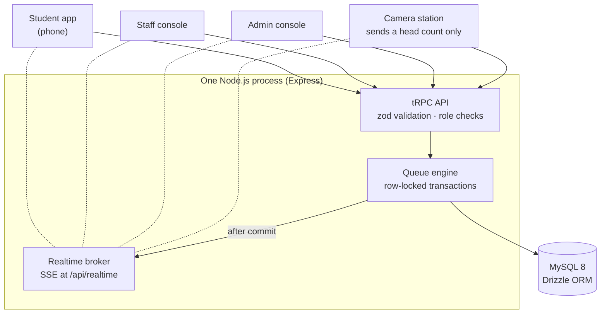

# QueueSense: Project Report

**Built by Puneet Sreevatsal Jagadam and Abhi Shiktha** as an independent project, out of personal
interest, without a course mentor.

<!--
  Every number here comes from the code, the test suite, git history or docs/testing.md.
  "This branch" means the code merged to main plus abhi/frontend-ux. Work on puneet/backend-deploy
  is described as such until it is merged; update those lines (and re-run Lighthouse) after merging.
-->

## Abstract

QueueSense is a realtime web app that lets students hold a place in campus service queues
(administration desks, print centre, cafeteria and lifts) and leave the physical line. The server
issues concurrency-safe tokens, computes each student's position and an explainable wait estimate,
and pushes every change to open browsers over Server-Sent Events. Staff run counters from a console:
calling, serving, priority with a reason, pausing, and merging a failed counter's line into another
without anyone losing their place. Administrators manage services, people and settings with an
audit trail. An optional camera station uses TensorFlow.js in the browser to estimate crowding and
sends only a head count. The app is written in TypeScript (React 19, Express, tRPC, MySQL 8) and is
checked by 115 automated tests against a real MySQL database, an axe-core accessibility audit and a
Lighthouse audit (Accessibility, Best Practices and SEO 100 on every page tested).

## 1. Introduction and motivation

We are two students who got tired of campus queues: waiting at the fee counter without knowing if
it would take five minutes or forty, losing our place if we stepped away, and printing queues that
fell apart when a printer jammed. We wanted to build something real and useful about it, not a
mock-up, and to use the project to learn the parts of full-stack development that tutorials tend to
skip:

- **Concurrency:** two people joining or two staff clicking "call next" at the same instant.
- **Realtime:** updating every open screen the moment the queue changes.
- **Security:** sessions, roles and checking every request on the server.
- **Accessibility:** making it usable on a small phone, with a screen reader and without colour.
- **Deployment:** running it on the public internet, not just on our laptops.

## 2. Problem statement and objectives

**Problem.** Students wait in physical lines with no idea how long the wait is and can't leave
without losing their place. Staff can only see the people in front of them and have no way to tell
waiting students about delays or a counter going down.

**Objectives.**

1. Hold a student's place digitally so they can leave the line.
2. Show an authoritative live position and an explainable, honest wait estimate.
3. Notify students when their turn approaches and whenever something changes.
4. Give staff fast, safe controls: call, serve, skip, priority, pause, merge.
5. Give administrators central configuration, people management, analytics and an audit trail.
6. Estimate physical crowding with computer vision without identifying anyone.
7. Work well on a 360 px phone and meet WCAG 2.1 AA.

**Scope.** Four services (Administration, Printing, Cafeteria, Elevator/Lift) run on one
configurable queue engine with no per-service code paths. QueueSense manages lines only: waits are
estimates, not appointments; the cafeteria queue holds a place but doesn't take orders or payment;
the lift queue is a virtual boarding queue and doesn't control lift hardware.

## 3. Features by role

| Role | Features |
| --- | --- |
| Student | Join by counter or "shortest line"; live ticket with token number, position, people ahead, estimated wait and countdown; "what changed" messages; cancel; history; notifications with per-type preferences and optional browser alerts; profile |
| Staff | Counter console with now-serving board; call next (or next lift batch), start serving, complete, skip no-show, cancel with reason; pause, take offline, merge into another counter; adjust traffic and add a delay; priority with a required reason; camera station |
| Admin | Live overview (stats, needs attention, system health, recent operations, charts); live queues; people management with activation codes; CSV bulk import with preview; services, queue groups, counters, staff assignments and camera stations; audit log; settings |
| Visitor | Landing page and sign-in. A one-click demo sign-in for each role is being added (Section 9) |

Screenshots of each are in the [Appendix](#appendix-screenshots).

## 4. Technology stack

| Layer | Choice | Why we chose it |
| --- | --- | --- |
| Language | TypeScript 5.9 everywhere | One language and shared types from database to UI |
| Frontend | React 19, Vite 7, wouter, TanStack Query 5 | React for components; Vite for fast builds and code splitting; wouter is a very small router; TanStack Query caches server data and makes "refetch when told something changed" simple |
| API | tRPC 11 on Express 4, zod validation | End-to-end typed calls without writing or generating an API client; zod validates every input on the server |
| Realtime | Server-Sent Events | Updates only flow server → browser, so SSE is enough: plain HTTP, built-in browser reconnection, no extra library |
| Database | MySQL 8 with Drizzle ORM | Transactions and row locks for the queue, generated columns and unique indexes to enforce rules, CHECK constraints; Drizzle gives typed queries and SQL migrations |
| Auth | Own sessions, scrypt hashing (Node's `crypto`) | Server-side sessions can be revoked; scrypt needs no native add-ons |
| Computer vision | TensorFlow.js + COCO-SSD in the browser | Frames never leave the device, only a count is sent |
| UI | Plain CSS design tokens, Radix Dialog, Recharts, sonner, lucide icons | Full control over a small custom design system; Radix for an accessible dialog; Recharts for admin charts |
| Testing | Vitest against a real MySQL test database, axe-core, Lighthouse | Concurrency bugs only show up against a real database |
| Delivery | Docker (`node:22-alpine`), GitHub Actions CI | Same image everywhere; CI runs `pnpm check`, `pnpm test` and `pnpm build` on pull requests and pushes to `main` |

## 5. System architecture

Solid arrows are requests. Dashed lines are each browser's Server-Sent Events stream: the browser
opens it once, and the broker pushes events down it. The server is the source of truth:
browsers send intentions ("join this queue", "call next"), the engine runs them in a transaction,
and only after the commit does the broker tell open browsers *that* something changed. Events carry
identifiers only; each browser then refetches the data it is allowed to see. More detail:
[architecture.md](architecture.md).

## 6. Key modules

**Queue engine** ([queue-engine.md](queue-engine.md)). Every action runs in a MySQL transaction with
row locks and a guarded state machine: waiting → called → serving → completed, with skipped and
cancelled exits. Token numbers are per counter per campus day (for example `F001`). The estimate is
`cyclesAhead × cycleSeconds + inProgress + staffDelay`, where the service time blends the configured
average with the median of recent completions, traffic multiplies it (×1.0, ×1.25, ×1.5) and a lift
serves a batch per trip. Merging a counter weaves the two lines (A1, B1, A2, B2) without deleting
any entry and remembers where each token came from.

**Realtime** ([realtime.md](realtime.md)). An in-process broker publishes after each commit; the SSE
endpoint streams identifier-only events to signed-in browsers. Clients coalesce bursts, refetch,
reconnect with backoff and resynchronise everything after a reconnect. Countdowns are anchored to
the server clock so every screen shows the same number.

**Security** ([security.md](security.md)). scrypt password hashes; random session tokens stored only
as HMAC digests; HttpOnly, SameSite=Lax cookies (Secure in production); a CSRF origin check on
writes; role checks plus object-level checks (staff only touch assigned counters, students only see
their own tokens); rate limits and lockout; audit log; CSP and HSTS in production; the server
refuses to start in production with an insecure origin or a placeholder secret.

**Computer vision** ([computer-vision.md](computer-vision.md)). COCO-SSD runs in the browser,
keeps only "person" detections whose centre is inside a configured area, smooths the count over the
last frames and sends it every 5 seconds. The count can raise a queue's traffic level but never
lower it, and is never added to the digital queue (people standing there may already hold tokens).
Stale counts are ignored.

**Database** ([database.md](database.md)). 18 application tables. The database itself enforces one
active token per student per queue (a stored generated column plus a unique index), a unique token
sequence per counter per day and CHECK constraints on configuration. A clean migration creates 31
foreign keys, 11 unique constraints and 6 CHECK constraints.

## 7. Development journey

| When | What happened |
| --- | --- |
| 27 Sep | **Prototype (Abhi).** Abhi created the repository and pushed the first QueueSense app, started from a Manus web-app template: five screens and a polished visual style, but the queue lived in the browser's `localStorage`, the API was public and there was no real realtime server ([starting-point audit](history/initial-audit.md)). |
| 27–28 Sep | **Full-stack rebuild (Puneet).** Puneet kept the stack and the visual ideas and rebuilt the rest: authentication and roles, the database schema, the transactional queue engine, SSE realtime, the student, staff and admin apps on real APIs, the "Wayfinding" design system, tests, production guards and a verification report. |
| 11 Oct | **Public repository.** Puneet added CI, a licence and deployment preparation; Abhi merged the rebuild into `main` through pull request #1. |
| 11 Oct | **Parallel polish on branches.** Abhi worked on `abhi/frontend-ux` (UI polish, 360 px mobile pass, Lighthouse audit, demo-mode UI, README visuals, docs). Puneet worked on `puneet/backend-deploy` (managed-MySQL TLS, ESLint, security review fixes, response compression, demo mode backend, Render deployment). The demo-mode API (`auth.demo`, `auth.demoLogin`) was agreed between the two branches, so the UI and the backend fit together. |

We used AI coding assistants as tools throughout, as many developers now do. They wrote drafts of
code and documentation; we decided what to build, reviewed the changes, ran the tests and checked
the app in the browser ourselves before merging anything.

## 8. Testing and quality

| Kind | What | Result |
| --- | --- | --- |
| Automated tests | 115 unit and integration tests in 14 files, run against a real MySQL test database: authentication, a permissions matrix of 26 privileged operations, state transitions, concurrency (25 simultaneous joins, racing duplicate joins, simultaneous "call next"), priority, merge and restore, traffic, notification isolation, import validation, SSE delivery, security headers and the full demo flow over HTTP and SSE | 115/115 pass; also run in CI on pull requests and pushes to `main` |
| Concurrency results | 25 parallel joins; 6 parallel joins by one student; 2 simultaneous "call next" on one desk | Tokens C001–C025 with no gaps or duplicates; exactly 1 token; exactly 1 call |
| Accessibility | axe-core (WCAG 2.1 A/AA and best practices) on 21 screens and dialogs; Lighthouse Accessibility | 0 violations after fixes; 100 on every page tested |
| Lighthouse (11 Oct, local production build, median of 3 runs) | Landing, sign-in, 404, student home, service page | Accessibility, Best Practices, SEO: 100. Performance: desktop 98–99, mobile 76–83 |
| Responsive | Every student, staff and admin screen at 360 × 780 with touch emulation; earlier checks at 390–1440 px | No horizontal scrolling; 44 px touch targets on touch screens |
| End-to-end | Scripted 12-step demo (`pnpm demo:smoke`) and a manual session with all three roles at once | All steps pass |

Mobile Lighthouse Performance was held back by uncompressed responses. Response compression has
since been added on `puneet/backend-deploy`; in an experiment with a temporary gzip proxy the same
build scored 93–98 on mobile, but the recorded scores above stay until Lighthouse is re-run after the
merge. Full matrix: [testing.md](testing.md).

## 9. Deployment

**Live demo:** [add the URL once deployed]

The app ships as one Docker image (`node:22-alpine`) that serves the API, the SSE stream and the
built frontend from one process, with a health check at `/api/health`. Production settings are
validated at startup ([deployment.md](deployment.md)).

The free hosting setup is on `puneet/backend-deploy` and not merged yet: a Render Blueprint
(`render.yaml`) runs the Docker image as a free web service and applies migrations before each
start, because the free plan has no pre-deploy step or shell. The database is a free managed MySQL
on Aiven over TLS, and an UptimeRobot check on `/api/health` every 5 minutes keeps the service
awake. The same branch adds the demo-mode backend (`auth.demo`, `auth.demoLogin`, shared demo
accounts, daily reset); the landing page's "Try as Student / Staff / Admin" panel is already built
and switches on once that is merged and its placeholder hook is swapped for the real call.

## 10. Team and contributions

From the git history up to 11 October 2026 (`main`, `abhi/frontend-ux` and `puneet/backend-deploy`).

| | Puneet Sreevatsal Jagadam | Abhi Shiktha |
| --- | --- | --- |
| Commits | 21 (12 merged to `main`, 9 on `puneet/backend-deploy`) | 15, plus 2 merges (repository setup and pull request #1) |
| Prototype | Starting-point audit of the prototype | Created the repository and the first prototype (27 Sep) |
| Backend | Auth, sessions and roles; schema and migrations; queue engine; SSE realtime; admin APIs; rate limits; production guards; security review fixes; response compression; demo mode backend; managed-MySQL TLS | Proposed the demo-mode API; recorded the missing response compression in the Lighthouse audit |
| Frontend | Role-based app on real APIs; "Wayfinding" design system; ticket states and change cues | 404 page and transitions; favicon and Open Graph image; 360 px mobile pass; layout-shift fix; accessible profile chip; lighter public pages; demo-mode panel |
| Quality | Test suite; verification and readiness reports; ESLint; CI | Lighthouse audit; responsive and touch checks; README screenshots and demo GIF |
| Deployment | Dockerfile, Render Blueprint, Aiven + UptimeRobot guide | Merged the rebuild into `main` (pull request #1) |
| Docs and presentation | Architecture, database, queue engine, realtime, security, deployment docs; presentation deck | This report, demo script, README visuals section, capture guide |

## 11. Challenges, learnings, limitations and future scope

**Challenges and what we learned.**

- **Concurrency is a database problem.** Computing "next number = max + 1" in application code, as
  the prototype did, breaks as soon as two requests overlap. Row locks inside transactions, plus a
  unique index the database enforces, made the 25-parallel-joins and duplicate-join tests pass
  every time.
- **Realtime is simpler when events carry no data.** Sending only "this changed" and letting each
  browser refetch keeps permissions in one place and makes reconnecting easy: refetch everything.
- **Streaming and compression don't mix.** A compressor buffers output, which would hold back SSE
  events, so compression has to skip the realtime stream.
- **Small UX details show up in measurements.** Lighthouse caught a layout shift of 0.406 on the
  student home and an accessible-name mismatch that looked fine visually; both were fixed.
- **Free hosting has constraints.** No pre-deploy step and a service that sleeps after 15 minutes
  shaped how migrations and health checks run.

**Limitations.** Wait times are heuristics, not appointments. The API runs as a single instance
(in-memory realtime and rate limits). There is no email delivery, self-service password reset or
administrator MFA. Not yet tested: live webcam detection, browser notifications with permission
granted, a screen-reader session and a hosted deployment. Mobile Lighthouse Performance needs a
re-run once compression is merged.

**Future scope.** Merge and verify the hosted demo; email or SMS notifications and self-service
password reset; Redis-backed realtime and rate limits for several instances; single sign-on with
the campus identity provider; dark mode; forecasting busy periods from history; a kiosk mode for
students without phones; QR check-in at counters.

## 12. Conclusion and links

QueueSense does what we set out to do: students hold a place from their phones and see a live,
explainable position; the database keeps the queue consistent under concurrent use; every open
screen updates within moments; and staff can deal with a counter going down, a priority case or a
lunch rush without anyone losing their place. Building it taught us far more about transactions,
realtime delivery, security and accessibility than a toy app would have.

- Repository: <https://github.com/itsabhi-cloud/campus-queue-manager>
- Live demo: [add the URL once deployed]
- 5-minute demo script: [demo-script.md](demo-script.md)
- Design system: [design-system.md](design-system.md) · Test matrix: [testing.md](testing.md)
- Licence: MIT

## Appendix: screenshots

Captured on 11 October 2026 from a freshly seeded development database
([how they were captured](images/README.md)).

**Demo: a live update reaching the student's phone**

| | |
| --- | --- |
|  Landing page |  Staff counter console |
|  Admin overview: needs attention and recent operations |  Camera station without a camera: "Camera unavailable" |

| | | | |
| --- | --- | --- | --- |
|  Student home |  Token after "Call next" |  Called: yellow means go |  Notifications |
